

	
	<h1 align="center">PhoShare showcase</h1>

A tour of PhoShare, the offline photo sharing app for those who don't have friends 😥. Everything here happens on one
phone, with no server, no cloud and no internet permission. The "friends" below (`lonely_lens`, `me.again` and
`still_me`) are all the same person, which is exactly the point.

## Getting in

Accounts live on the device. Sign up with a username, a password and a security question, and you stay logged in
until you log out.

<table>
  <tr>
    <td align="center">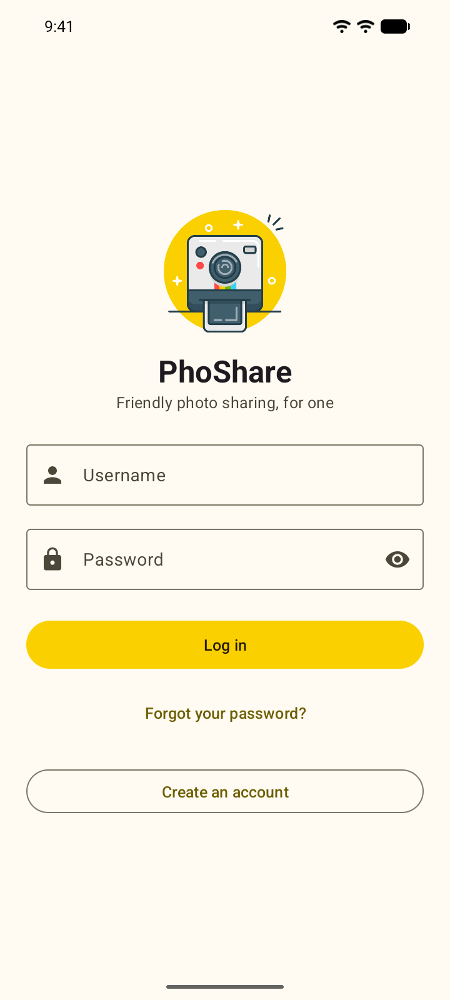</td>
    <td align="center">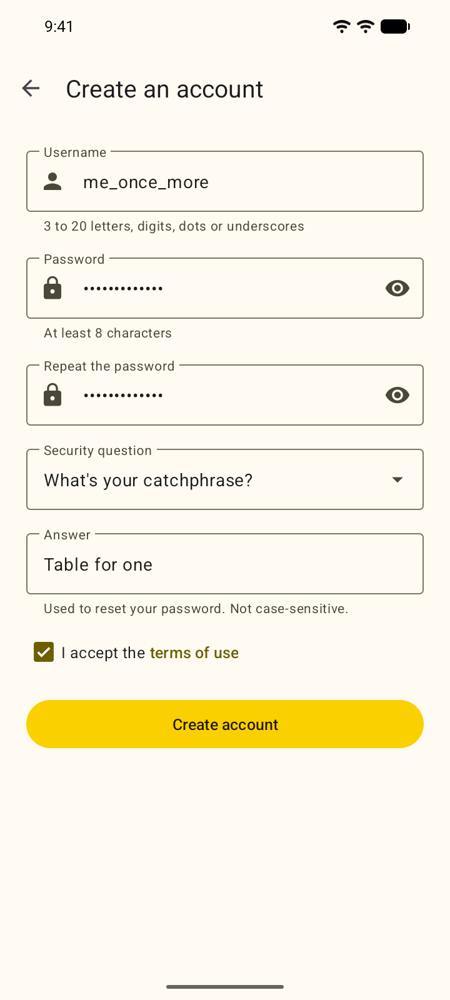</td>
    <td align="center">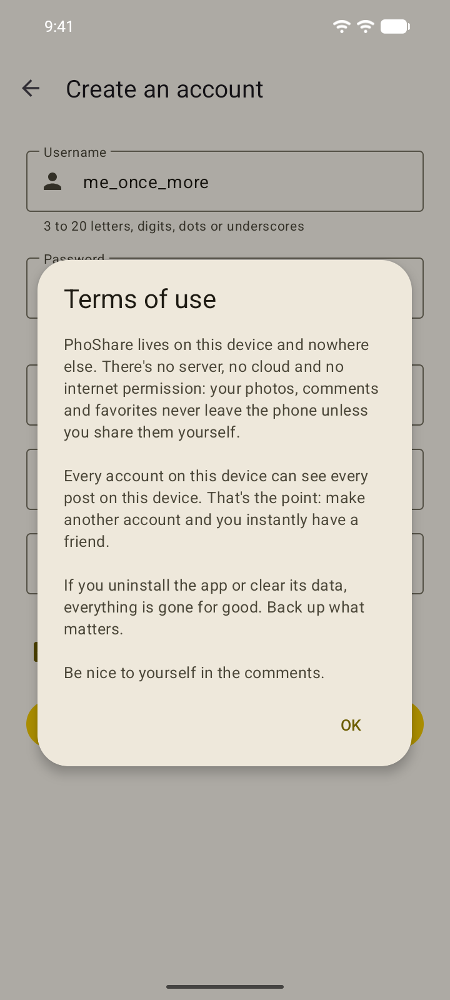</td>
  </tr>
  <tr>
    <td align="center"><b>Log in</b></td>
    <td align="center"><b>Create an account</b> with a security question</td>
    <td align="center"><b>Terms of use</b> short, honest and offline</td>
  </tr>
</table>

Forgot your password? Answer your security question and pick a new one. The answer isn't case-sensitive, and both the
password and the answer are stored only as PBKDF2 hashes.

<table>
  <tr>
    <td align="center">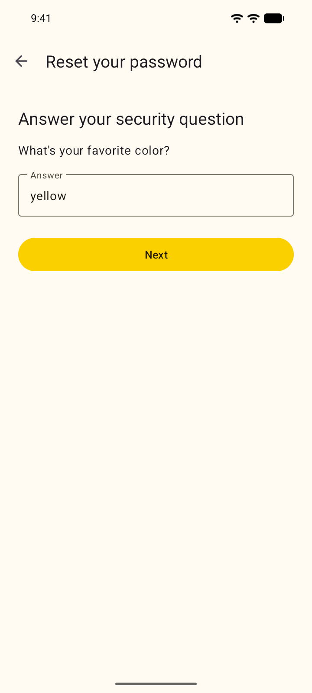</td>
  </tr>
  <tr>
    <td align="center"><b>Reset your password</b> username, question, new password</td>
  </tr>
</table>

## The feed

Every post on the device, newest first, with favorites, comment counts and a share button. A brand-new device starts
out a little lonely, and the app suggests the obvious fix.

<table>
  <tr>
    <td align="center">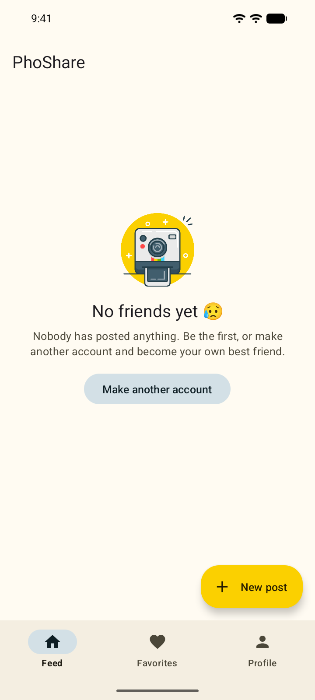</td>
    <td align="center">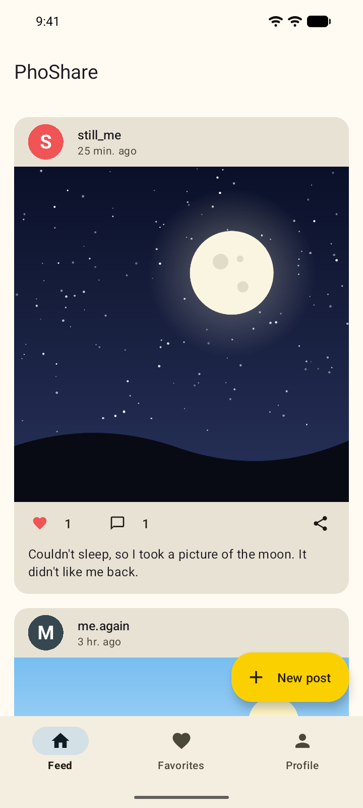</td>
  </tr>
  <tr>
    <td align="center"><b>No friends yet 😥</b> make another account</td>
    <td align="center"><b>The feed</b> now with "friends"</td>
  </tr>
</table>

## Posting, commenting and sharing

Pick a photo from the system photo picker or take one with the camera app. Neither needs a permission. Photos are turned
upright and scaled down before they're saved. Open a post to read and write comments, or send the photo to another app
through Android's share sheet, the only way anything leaves the phone.

<table>
  <tr>
    <td align="center">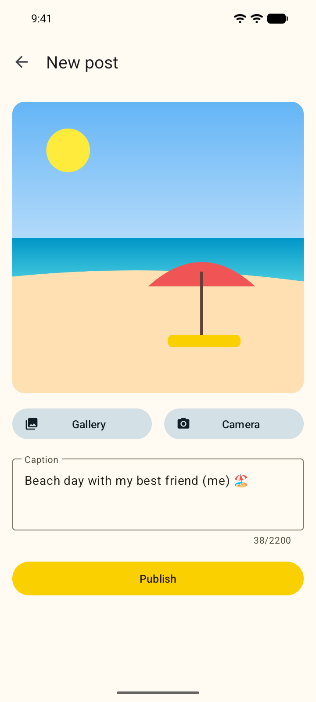</td>
    <td align="center">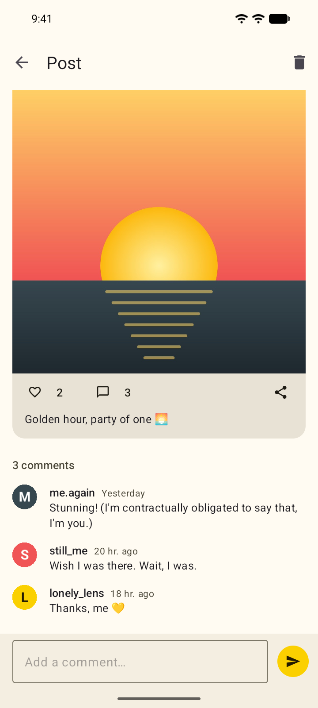</td>
    <td align="center">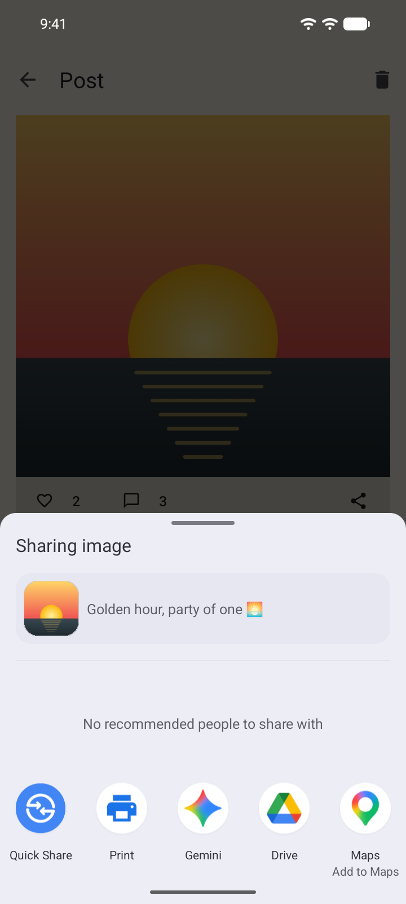</td>
  </tr>
  <tr>
    <td align="center"><b>New post</b> gallery or camera, plus a caption</td>
    <td align="center"><b>A post</b> favorites and comments</td>
    <td align="center"><b>Share</b> to any app on the phone</td>
  </tr>
</table>

## Favorites and profiles

Tap the heart to keep a post in your favorites. Every account has a profile with an avatar, a bio, its join date and a
grid of its photos. Your own profile is also where you edit your avatar and bio, change your password, log out or
delete your account.

<table>
  <tr>
    <td align="center">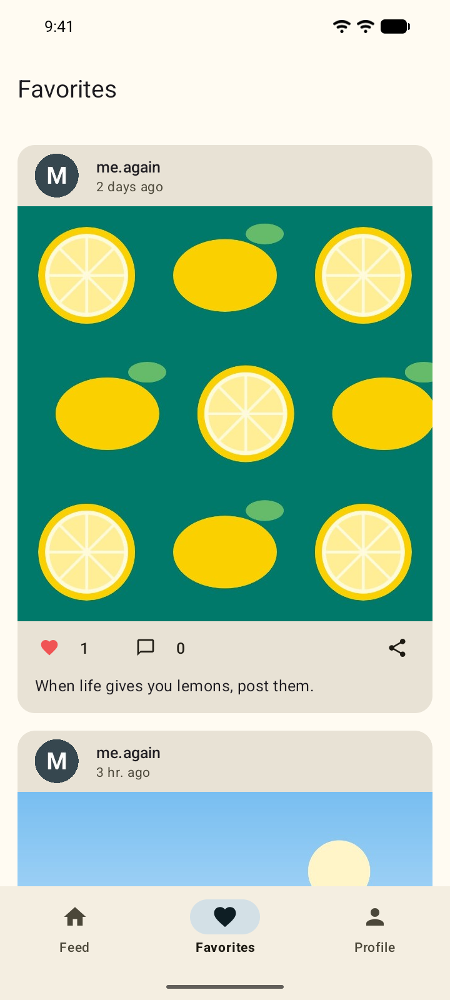</td>
    <td align="center">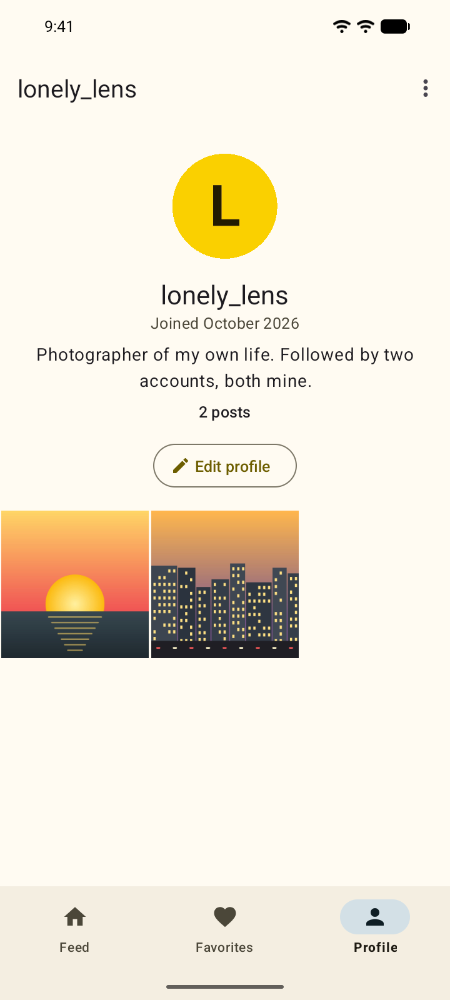</td>
  </tr>
  <tr>
    <td align="center"><b>Favorites</b> the latest favorite first</td>
    <td align="center"><b>Your profile</b> account actions in the menu</td>
  </tr>
  <tr>
    <td align="center">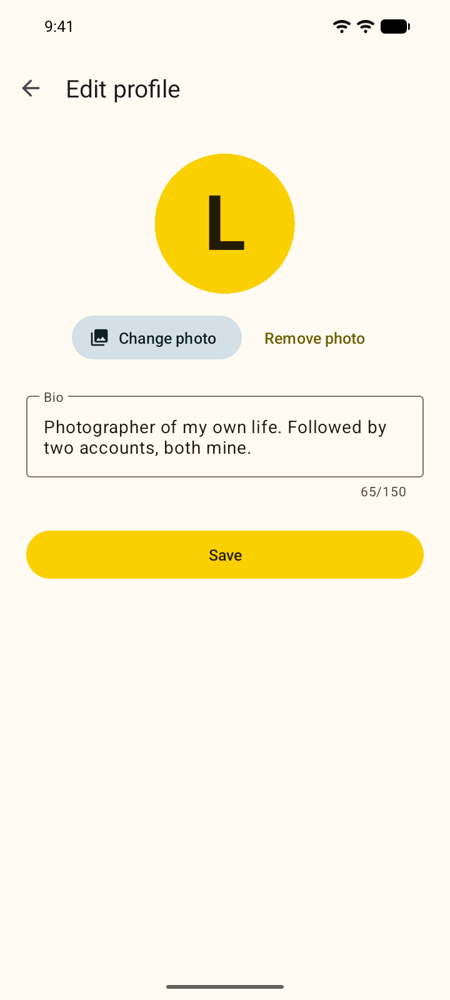</td>
    <td align="center">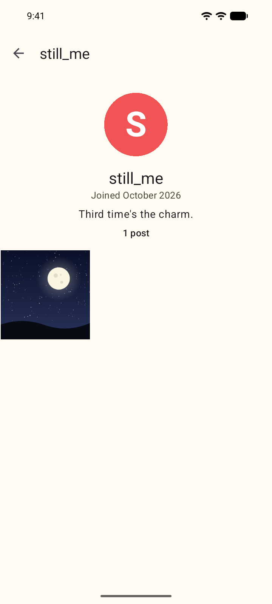</td>
  </tr>
  <tr>
    <td align="center"><b>Edit profile</b> avatar and bio</td>
    <td align="center"><b>Someone else's profile</b> (it's still you)</td>
  </tr>
</table>

## Dark mode

The theme takes its colors from the logo: warm yellow, slate gray and a touch of the rainbow stripe. It follows the
system's dark mode.

<table>
  <tr>
    <td align="center">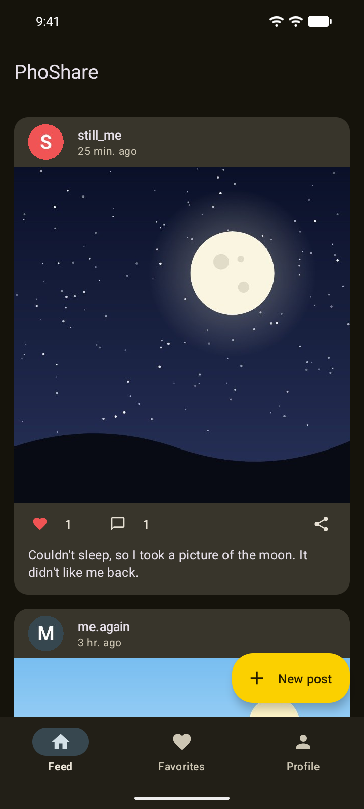</td>
    <td align="center">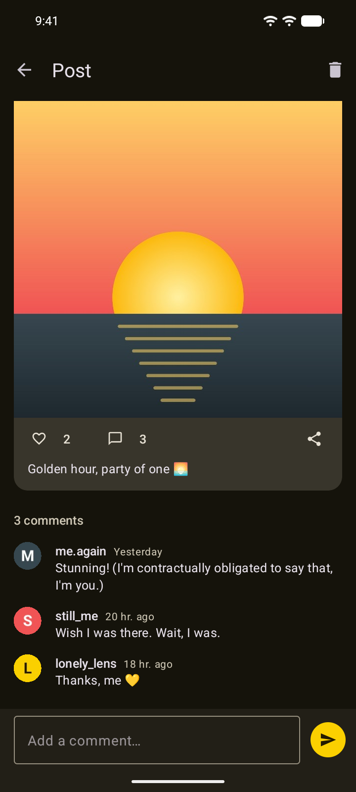</td>
  </tr>
  <tr>
    <td align="center"><b>Feed</b></td>
    <td align="center"><b>Post</b></td>
  </tr>
</table>

---

The screenshots come from the Android 17 emulator that the project's own tooling runs (`./android.ps1 emulator` or
`./android.sh emulator`). The accounts, photos and comments were seeded for the tour; the photos were drawn in code,
since a lonely phone has no camera roll to borrow from. See the [README](README.md) to build and run it yourself.
